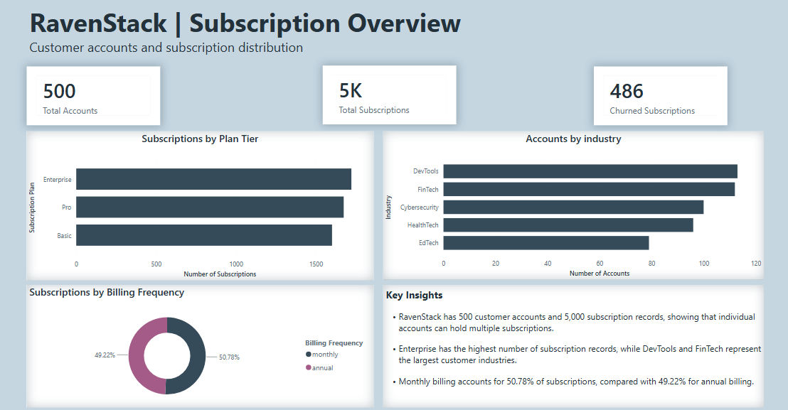
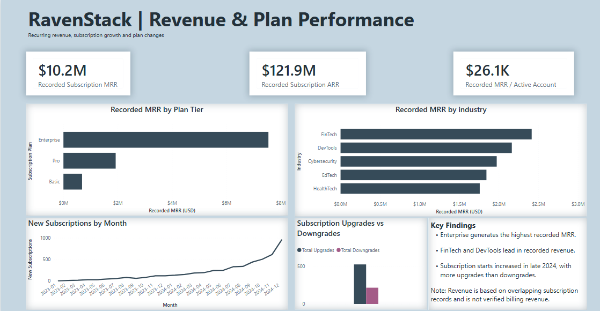

# RavenStack | SaaS Subscription Performance Dashboard

## Project Overview

This project is an interactive Power BI dashboard developed to analyse subscription performance for RavenStack, a fictional SaaS business.

The dashboard uses a synthetic dataset containing 500 customer accounts and 5,000 subscription records, alongside feature usage, support ticket and churn event data.

The aim is to explore customer distribution, subscription activity, recorded recurring revenue and differences across subscription plans and industries.

The project demonstrates practical skills in Power BI, Power Query, data modelling, DAX and business intelligence reporting.

## Dashboard Preview

### Page 1: Subscription Overview



This page provides an overview of customer accounts and subscription records.

Key metrics and visuals include:

- Total customer accounts
- Total subscription records
- Churned subscription records
- Subscription distribution by plan tier
- Customer accounts by industry
- Monthly versus annual billing frequency

### Page 2: Revenue & Plan Performance



This page explores recorded subscription revenue and plan activity.

Key metrics and visuals include:

- Recorded monthly recurring revenue (MRR)
- Recorded annual recurring revenue (ARR)
- Recorded MRR per active account
- Recorded MRR by subscription plan
- Recorded MRR by customer industry
- Monthly subscription starts
- Subscription upgrades versus downgrades

## Dataset

The project uses five CSV files:

| Dataset | Records | Description |
|---|---:|---|
| accounts | 500 | Customer account information, including industry and signup dates |
| subscriptions | 5,000 | Subscription plans, billing information, revenue and status |
| feature_usage | 25,000 | Product feature usage activity |
| support_tickets | 2,000 | Customer support records |
| churn_events | 600 | Recorded churn events |

The data is synthetic and is intended for analysis and portfolio development.

Dataset credit: River @ Rivalytics.

## Tools and Technologies

- Power BI Desktop: Dashboard development and visualisation
- Power Query: Data preparation and transformation
- DAX: Calculated measures and time-based analysis
- Data Modelling: Relationships between customer, subscription and activity tables
- GitHub: Version control and project documentation

## Data Preparation and Modelling

The data was imported from CSV files and prepared using Power Query.

The Power BI data model connects customer accounts to subscriptions, support tickets and churn events. Feature usage records are linked to subscriptions.

A dedicated date table was created to support time-based analysis. The model uses active and inactive date relationships, with DAX measures applying the relevant relationship when required.

Measures were developed to calculate account totals, subscription totals, recorded recurring revenue, churn indicators, monthly subscription starts and plan changes.

## Key Findings

### 1. Subscription Overview

- The dataset contains 500 customer accounts and 5,000 subscription records, indicating that individual accounts can have multiple subscription records.
- Enterprise has the highest number of recorded subscriptions.
- DevTools and FinTech have the largest customer account counts.
- Monthly billing represents 50.78% of subscription records, compared with 49.22% for annual billing.
- A total of 486 subscription records are flagged as churned.

### 2. Revenue & Plan Performance

- Recorded subscription MRR is approximately $10.2 million, with an annualised equivalent of approximately $121.9 million.
- Enterprise contributes the highest recorded MRR among subscription plans.
- FinTech and DevTools contribute the highest recorded MRR among customer industries.
- Recorded subscription starts increase towards December 2024.
- More subscription records are flagged as upgrades than downgrades.

## Data Quality and Interpretation

Several limitations should be considered when interpreting the results.

**Overlapping subscription records:** Some customer accounts have subscription records with overlapping periods. The dataset does not establish whether these represent separate billable subscriptions, historical plan changes or duplicated billing periods.

**Revenue interpretation:** Revenue measures aggregate recorded MRR values for subscriptions that are not flagged as churned or trials. They should not be interpreted as verified current billing revenue. ARR is calculated by annualising this recorded MRR.

**Churn interpretation:** Account-level churn, subscription-level churn and churn event records use different definitions. These metrics should not be treated as interchangeable.

**Subscription growth:** The monthly subscription-start measure was validated against counts grouped directly by subscription start date. December 2024 contains 953 recorded starts. As the dataset is synthetic, this trend does not establish genuine business or customer growth.

These limitations are important when drawing business conclusions from the dashboard.

## Repository Structure

```text
ravenstack-subscription-performance/
├── data/
│   ├── ravenstack_accounts.csv
│   ├── ravenstack_subscriptions.csv
│   ├── ravenstack_feature_usage.csv
│   ├── ravenstack_support_tickets.csv
│   └── ravenstack_churn_events.csv
├── powerbi/
│   └── ravenstack_subscription_performance.pbix
├── screenshots/
│   ├── subscription_overview.png
│   └── revenue_plan_performance.png
└── README.md
```

## How to View the Dashboard

1. Download the `.pbix` file from the `powerbi` folder.
2. Open it using Microsoft Power BI Desktop.
3. Explore the Subscription Overview and Revenue & Plan Performance report pages.

The screenshots above provide a preview without requiring Power BI Desktop.

If refreshing the dataset, update the CSV source paths in Power Query to match the downloaded files.

## Skills Demonstrated

- Designing interactive Power BI dashboards
- Transforming and preparing CSV data
- Building relational data models
- Creating DAX measures
- Analysing SaaS subscription and revenue metrics
- Validating calculated results against source data
- Communicating business insights and data limitations
- Documenting an analytics project using GitHub

## Data Attribution

Synthetic RavenStack dataset credited to River @ Rivalytics.

This is an independent portfolio project created for educational and professional development purposes.